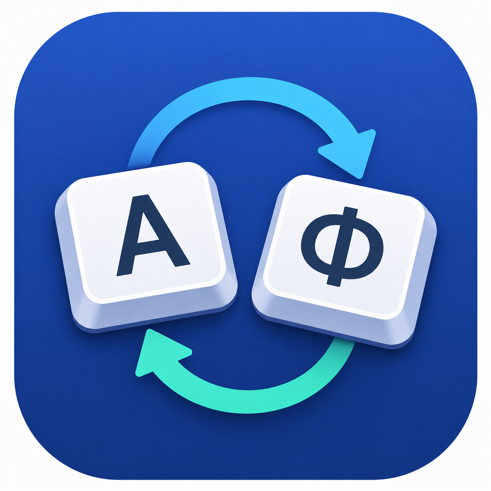

# LayoutSwitcher

<p align="center">
  
</p>

<p align="center">
  <em>An automatic keyboard-layout corrector for macOS — the modern alternative to Punto Switcher and Caramba.</em>
</p>

<p align="center">
  <a href="https://github.com/efanchik/LayoutSwitcher/actions/workflows/ci.yml">
    
  </a>
  
  
</p>

---

## What it does

You start typing a word with the wrong keyboard layout active — for example `ghbdtn` on the English layout when you actually meant Russian `привет`. LayoutSwitcher notices the mismatch as soon as the word boundary is committed, switches the input source for you, deletes the garbled characters, and retypes the word in the correct layout. Multi-word bursts, sentence-wide manual conversion, and per-application preferred layouts are all supported.

It runs as a lightweight menu-bar agent (no Dock icon, no main window) and ships its own dictionaries and n-gram language models, so no network access or background services are required.

## Features

- **Auto-detect & retype** — word-by-word analysis backed by per-language dictionaries, n-gram models, and `NSSpellChecker` cross-checks.
- **Language pairs** — EN ↔ RU, EN ↔ UK, EN ↔ RO out of the box; new pairs only need a mapping table and a dictionary.
- **Romanian diacritics** — optional automatic insertion of `ă/â/î/ș/ț` when typing on the Romanian layout.
- **Manual hotkeys** — force-retype the last word, convert the last sentence, smart-paste from clipboard with auto-language detection, undo the last auto-switch, snooze.
- **Per-app preferred layout** — assign a specific input source to a bundle ID; LayoutSwitcher switches to it on focus change.
- **Exclusion list** — disable corrections in terminals, IDEs, password managers, or any app you mark.
- **Learning cache** — remembers manual corrections so the same word isn't auto-flipped against your intent next time.
- **History scrubber** — searchable, filterable table of recent corrections with TSV export, persisted across launches.
- **Snooze / presentation mode** — temporary pause via hotkey or auto-detection of full-screen presenter apps.
- **Sound & visual feedback** — optional click and on-screen flash on each successful switch.
- **Localized UI** — English, Russian, Ukrainian, Romanian.

## How it works

| Layer | Responsibility |
| --- | --- |
| `KeyboardEventTap` (`CGEventTap`) | Intercepts every keystroke globally |
| `WordBuffer` | Accumulates characters until a separator commits the token |
| `LayoutDetector` | Decides `.keep` / `.switchAndRetype` / `.ambiguous` from dictionaries + n-grams |
| `SequenceDetector` | Joins consecutive wrong-layout words into one block retype |
| `TypingPipeline` | Orchestrates the above, schedules retypes, manages presentation/snooze gates |
| `RetypeDispatcher` | Owns the retype lifecycle (cooldown, async retyper, post-retype side effects) |
| `Retyper` | Selects the target input source (`TISSelectInputSource`) and synthesizes key events (`CGEvent.post`, `UCKeyTranslate`) |
| `HotkeyCoordinator` | Routes Carbon hotkeys to manual actions |

`CGEventTap` requires the Accessibility permission and is incompatible with the App Sandbox, so distribution is via Developer ID + notarization rather than the Mac App Store.

## Requirements

- macOS 15.0 or later (built and tested against 15.7).
- Xcode 26.x with the Swift 6.2 toolchain.
- Accessibility permission granted to the app on first launch (the onboarding window guides you through it).

## Build & run

```bash
xcodebuild build -scheme LayoutSwitcher -destination 'platform=macOS'
```

Or open `LayoutSwitcher.xcodeproj` in Xcode and run the `LayoutSwitcher` scheme.

On first launch the app:

1. Shows an onboarding window asking for Accessibility permission.
2. Opens System Settings → Privacy & Security → Accessibility for you to toggle the app on.
3. Returns to the menu bar and starts intercepting keystrokes once permission is granted.

## Install from a DMG

For tester builds, the app may be distributed as a `LayoutSwitcher.dmg` file outside the Mac App Store.

Current tester release:

```text
https://github.com/efanchik/LayoutSwitcher/releases/tag/v0.1.0-test.1
```

1. Open the release page above and download `LayoutSwitcher.dmg` from the `Assets` section.
2. Double-click the DMG file to mount it.
3. Drag `LayoutSwitcher.app` to your `Applications` folder.
4. Eject the mounted `LayoutSwitcher` disk image.
5. Open `LayoutSwitcher.app` from `Applications`.

If macOS blocks the first launch because the app was downloaded from the internet or is not notarized:

1. Open Finder and go to `Applications`.
2. Control-click or right-click `LayoutSwitcher.app`.
3. Choose `Open`.
4. Confirm the security prompt.

After the app launches, grant the required macOS permissions:

1. Open `System Settings`.
2. Go to `Privacy & Security`.
3. Enable `LayoutSwitcher` under `Accessibility`.
4. Enable `LayoutSwitcher` under `Input Monitoring` if macOS asks for it.
5. Restart `LayoutSwitcher` if macOS requests it after changing permissions.

Why these permissions are required:

- `Accessibility` lets LayoutSwitcher observe global keyboard input and retype corrected text.
- `Input Monitoring` may be required by macOS for low-level keyboard event access.

Tester note: non-notarized DMG builds are suitable for private testing, but macOS Gatekeeper can show extra warnings. Public distribution should use Developer ID signing and notarization.

## Tests

```bash
xcodebuild test -scheme LayoutSwitcher -destination 'platform=macOS' -only-testing:LayoutSwitcherTests
```

The full unit-test suite covers the typing pipeline, layout detector, retyper, dictionaries, n-gram scorers, manual-action hotkeys, persistence, and per-app preferences. CI runs the same command on every push and pull request — see [`.github/workflows/ci.yml`](.github/workflows/ci.yml).

## Project layout

```text
LayoutSwitcher/
├── App/              # AppDelegate, AppState, launch wiring
├── Buffer/           # WordBuffer, separators, token-boundary policy
├── Detector/         # LayoutDetector, n-gram models, language scorers
├── Dictionary/       # Bundled and user dictionaries, Romanian resolver
├── EventTap/         # CGEventTap, accessibility permission, secure input guard
├── Feedback/         # Sound and visual feedback players
├── Hotkeys/          # Carbon hotkey registry & coordinator
├── InputSource/      # TIS wrapper + InputSourceManaging protocol
├── Mapping/          # Keyboard mappings, retyper, smart paste, selection converter
├── Notifications/    # User-notification manager
├── Pipeline/         # TypingPipeline, dispatcher, manual coordinator, learning cache
├── Stats/            # UsageStats, RecentSwitches, ExclusionList, PerAppLayoutPreferences
└── UI/               # Settings tabs, onboarding, history, help, status bar renderer
```

## Acknowledgements

Inspired by Yandex Punto Switcher and Caramba Switcher, both of which are no longer maintained on modern macOS.
